# Markdown report with before/after explain() output.

### Added the Dummy Notes

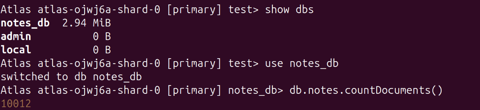

## 1. find({ title: /foo/ }) without an index

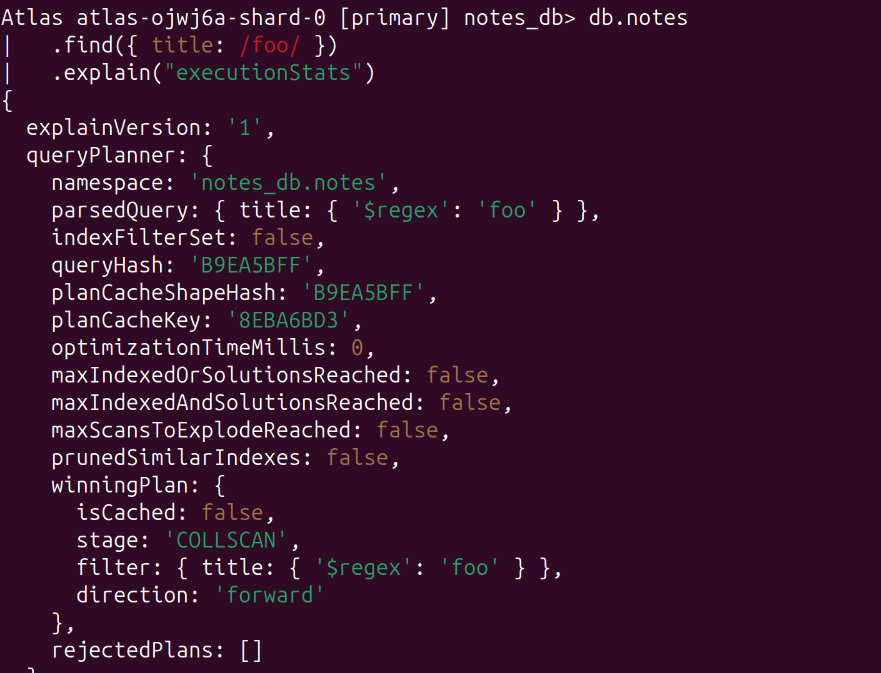
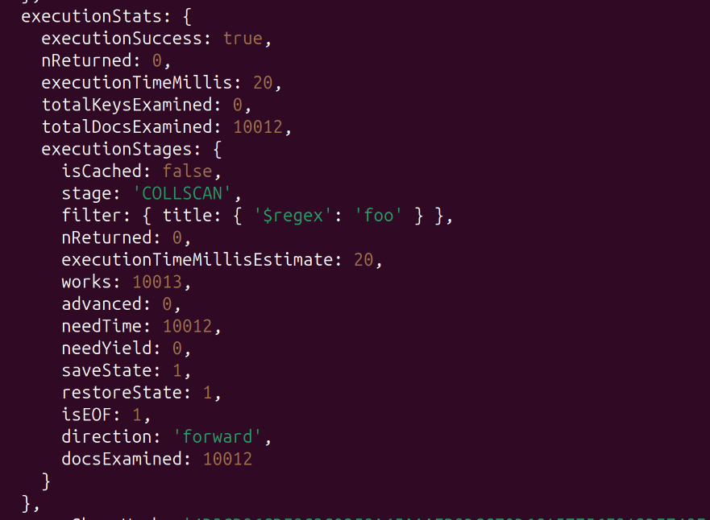

### find({ title: /foo/ }) with an index

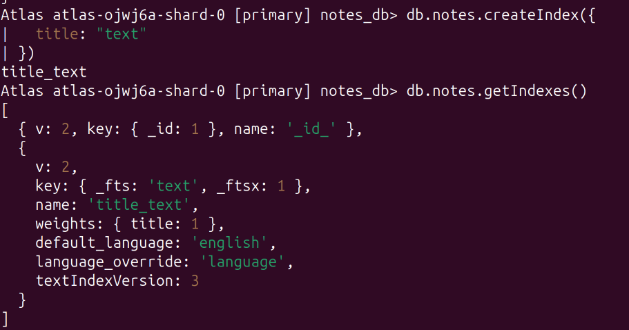

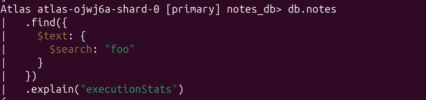
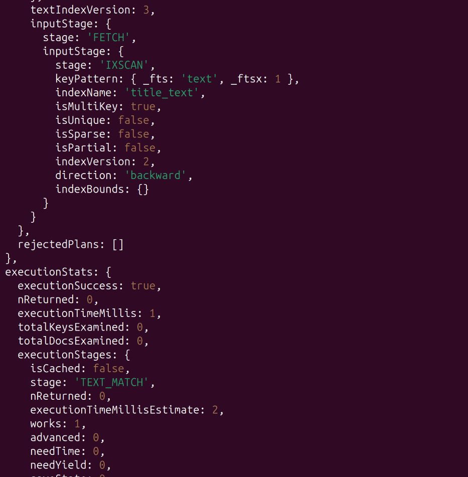

---

## 2. Add a text index on title and use $text 

### Without an Index

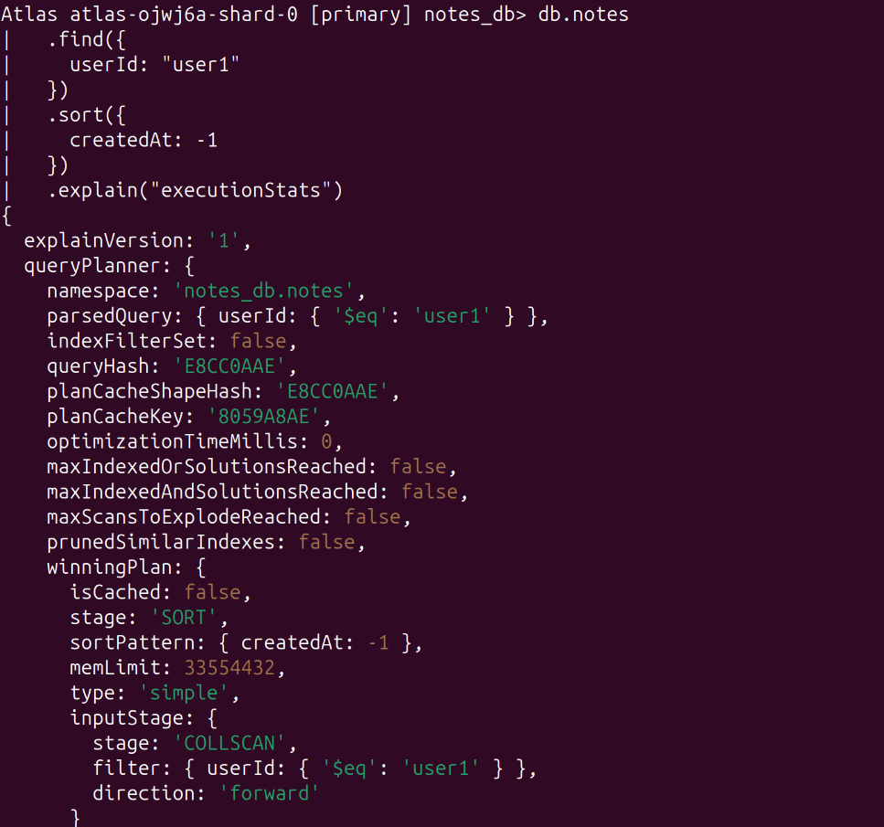
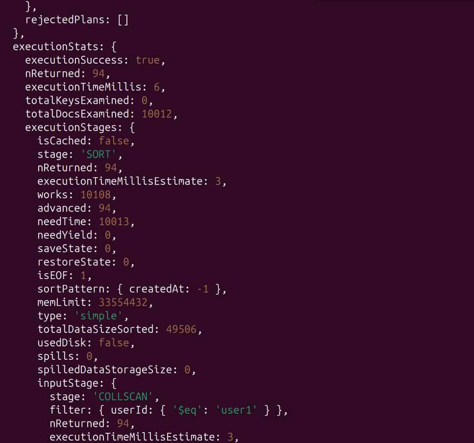

### Created an Index

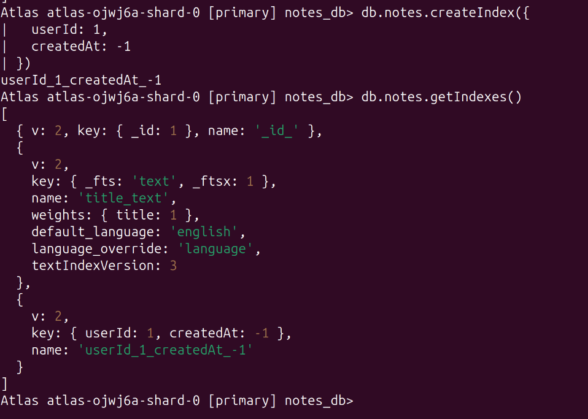

### With an Index 

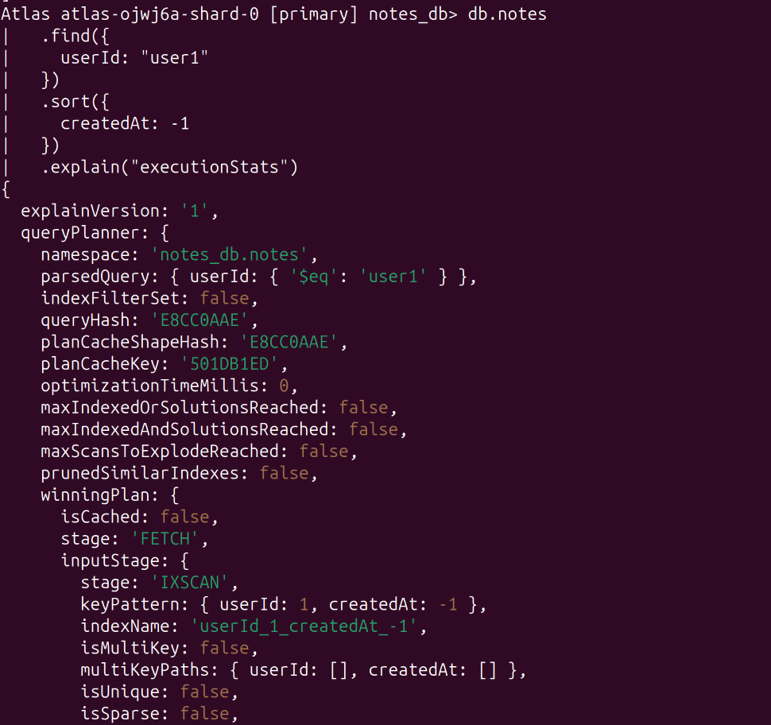
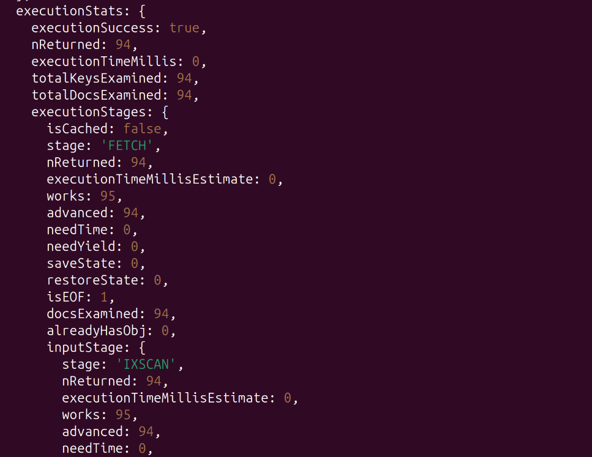